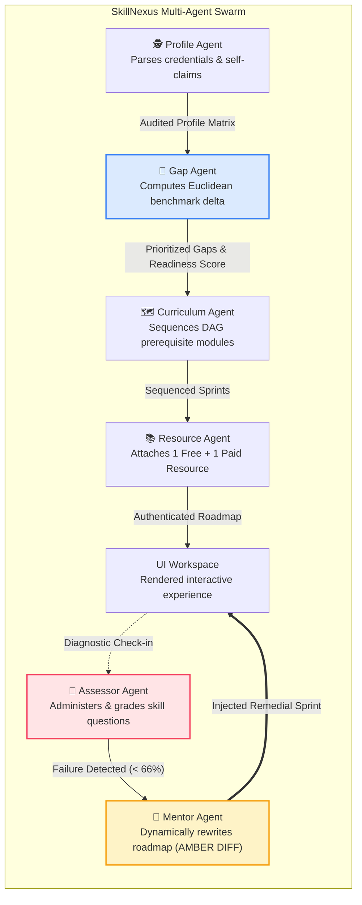

# SkillNexus-AI 🎓⚡
### Autonomous Multi-Agent Career & Skill Orchestration Platform
*Built with Google Antigravity for PromptWars @ Rathinam Technical Campus (RTC), Coimbatore*

[](https://fastapi.tiangolo.com)
[](https://python.org)
[]()
[]()
[-blue)]()

---

## 💡 The Core Problem & Our Winning Insight

Most traditional e-learning platforms treat all learners identically: they spit out a generic, static list of courses. Furthermore, **self-reported skills on resumes are notoriously unreliable** — candidates often rate themselves 5/5 in Python or JavaScript when they cannot explain how closures or the event loop function.

**SkillNexus-AI introduces the Claimed vs. Verified Knowledge Matrix.**
Every skill is tracked across two distinct axes:
1. **Claimed Level (1–5):** What the learner self-reports on their profile.
2. **Verified Level (1–5):** What has been scientifically validated through rigorous diagnostic assessments.

The gap between these two numbers is the **Credibility Delta**. SkillNexus bridges this delta by autonomously orchestrating adaptive, personalized learning roadmaps that visibly rewrite themselves when a learner struggles or shifts career targets.

---

## 📐 Deterministic Readiness Formula (Zero LLM Hallucinations)

Unlike standard AI chatbots that guess a random readiness percentage, SkillNexus uses a **verifiable, deterministic benchmark formula**:

$$\text{Verified Readiness (\%)} = \frac{\sum_{i=1}^{N} \min(\text{verified\_level}_i, \text{required\_level}_i) \times \text{weight}_i}{\sum_{i=1}^{N} \text{required\_level}_i \times \text{weight}_i} \times 100$$

$$\text{Claimed Readiness (\%)} = \frac{\sum_{i=1}^{N} \min(\text{claimed\_level}_i, \text{required\_level}_i) \times \text{weight}_i}{\sum_{i=1}^{N} \text{required\_level}_i \times \text{weight}_i} \times 100$$

$$\text{Credibility Delta} = \text{Claimed Readiness} - \text{Verified Readiness}$$

Each skill gap is mathematically prioritized by its **Severity Score**:
$$\text{Severity Score} = (\text{required\_level} - \text{verified\_level}) \times \text{weight}$$

---

## 🤖 The 6 Collaborating Specialized Agents



1. **🕵️ Profile Agent:** Normalizes learner resumes, certifications, and skills; separates claimed vs verified mastery.
2. **🎯 Gap Agent:** Evaluates candidate competency against enterprise role benchmarks (Full Stack, AI/ML, Cloud DevOps) and isolates missing competencies.
3. **🗺️ Curriculum Agent:** Orders sprints by dependency DAG, allocates realistic pacing hours, and prevents cognitive overload.
4. **📚 Resource Agent:** Maps 1 authoritative free resource (MDN, official specs) + 1 deep production course (Coursera, Frontend Masters) per sprint with verified URLs.
5. **📝 Assessor Agent:** Generates concept-focused diagnostic check-ins and detects fundamental misconceptions.
6. **🧠 Mentor Agent (The Adaptive Engine):** Intervenes when a student fails a diagnostic or changes career tracks. It **visibly rewrites the roadmap**, injecting remedial micro-sprints and shifting downstream modules with an amber visual diff!

---

## 🎬 90-Second Stage Pitch Script (Judges' Guide)

* **[0:00 - 0:10] Hook:** "Students don't know what they're missing, and legacy platforms dump the exact same course on everyone. Resumes are full of claimed skills with zero proof."
* **[0:10 - 0:30] Walkthrough:** "Select Aarav Patel targeting Full Stack Developer. Watch our 6 agents run live. His self-claimed readiness is 53.6%, but his verified enterprise fit is only 30.9%."
* **[0:30 - 0:40] The Gap:** "Point to React and Node.js: Weight 5, verified level 0. These are critical voids blocking hiring."
* **[0:40 - 1:05] The Adaptive Clincher:** "Let's click 'Take Check-in' on JavaScript. Click 'Simulate Weakness' — he scores 33% on event loop and closures. Notice what happens: The Mentor Agent immediately injects a 12-hour Remedial Scope Sprint and delays React with a highlighted amber diff."
* **[1:05 - 1:20] Adaptivity Proof:** "The curriculum adapted in real time to the student's actual cognitive need. Switch to AI Engineer, and the entire graph recalibrates in under 200 milliseconds."
* **[1:20 - 1:30] Closing:** "Readiness is computed with verifiable mathematics, never guessed by an LLM. Built with Google Antigravity."

---

## 🚀 Running SkillNexus Locally (1 Command)

### Prerequisites:
- Python 3.10+
- Git

### Installation & Launch:
```bash
# Clone the repository
git clone https://github.com/abinivesh-m/Skillnexus-ai.git
cd Skillnexus-ai

# Install dependencies (ultra-lightweight, no heavy frameworks)
pip install -r requirements.txt

# Run the local server
python -m uvicorn main:app --port 8000
```
Open **[http://localhost:8000](http://localhost:8000)** in your browser!

---

## 🏆 Hackathon Compliance Checklist
- [x] **Repository is 100% Public:** `https://github.com/abinivesh-m/Skillnexus-ai`
- [x] **Single Branch:** Strictly `main` branch only.
- [x] **Repository Size:** Under 1 MB (Far below the 10 MB limit).
- [x] **Agentic AI:** 6 collaborating specialized agents with observable handoff logs.
- [x] **Adaptive Re-planning:** Real-time roadmap rewrites upon assessment failure or career switch.
- [x] **Prompt Scenario:** Pre-seeded with the exact prompt scenario (Student with Python/SQL targeting Full Stack).

---
*Developed for PromptWars Coimbatore 2026.*
