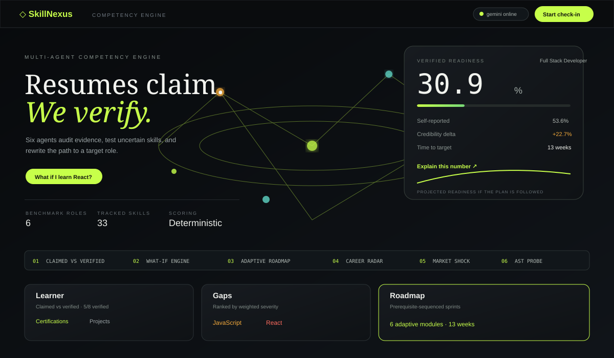
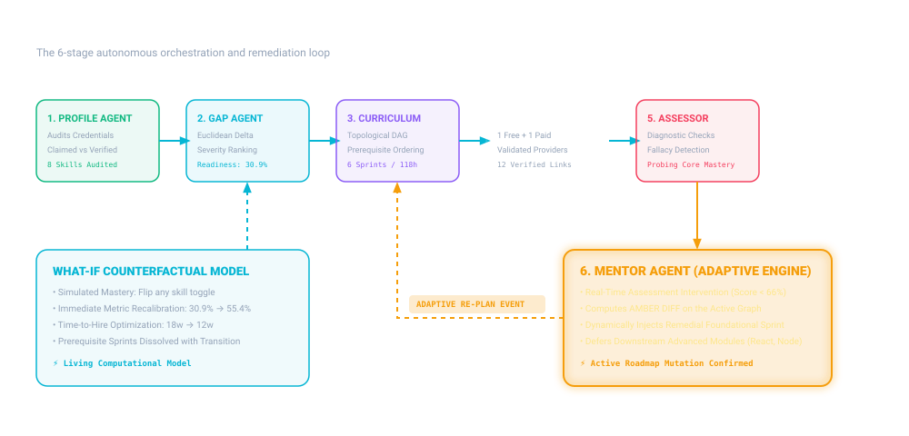
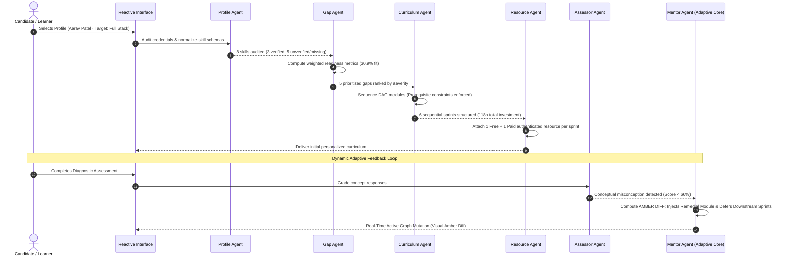

# SkillNexus-AI
### Verified skill gaps. Computed career paths. Adaptive learning plans.

Live application: **https://skillnexus-ai.vercel.app**

## Judge quickstart

1. Open the live application.
2. Press **Run 10s demo**. The numbered callout explains each agent handoff and highlights the exact panel being changed.
3. Click **Explain this number** to inspect the weighted readiness calculation.
4. Click **Start check-in**, answer the diagnostic, and observe correct answers, explanations, and the adaptive re-plan.
5. Toggle **What if I learn React?** to see a deterministic counterfactual change the score and schedule.

### The one-line pitch

**SkillNexus proves what a learner knows, computes the gap to a target role, and adapts the learning path when new evidence arrives.**

SkillNexus-AI is a multi-agent career-planning platform for identifying the difference between what a learner claims and what they can demonstrate. It audits a learner profile, benchmarks it against a target role, tests uncertain skills, and rewrites the learning path when evidence changes.

[](https://fastapi.tiangolo.com)
[](https://python.org)
[]()
[]()
[]()
[](https://skillnexus-ai.vercel.app)

---

## System Interface Preview



---

## 1. Executive Summary & Problem Analysis

Organizations and higher-education institutions face a critical structural inefficiency: **traditional learning management systems (LMS) treat all learners homogenously**, presenting static course catalogs without accounting for baseline competencies, cognitive pacing, or specific industry role requirements.

Furthermore, **self-reported skill ratings on resumes and professional profiles are fundamentally unreliable**. Candidates routinely self-designate as "Advanced" or "Expert" in core competencies while failing to demonstrate working knowledge of fundamental principles during technical evaluation.

### The Solution: Claimed vs. Verified Knowledge Matrix
**SkillNexus-AI** decouples skill tracking into two distinct, rigorous vectors:
* **Claimed Level ($L_{\text{claimed}} \in [1, 5]$):** Self-reported capability from credentials, resumes, or profile declarations.
* **Verified Level ($L_{\text{verified}} \in [1, 5]$):** Empirically demonstrated capability, validated through diagnostic concept probes.

The arithmetic difference between these metrics constitutes the **Credibility Delta**. SkillNexus bridges this delta by deploying an autonomous collaborative swarm of **6 specialized AI agents** that dynamically structure, sequence, and adapt learning trajectories based on verified competence.

---

## 2. System Architecture & Data Pipeline

The system is architected across three decoupled tiers: an Ingestion & Ontology Layer, a Multi-Agent Swarm Engine, and a Reactive Presentation Layer.


### Multi-Agent Lifecycle & Dynamic Feedback Loop

The platform employs a reactive event bus where specialized agents collaborate sequentially during baseline profiling, and cyclically during adaptive re-planning:





---

## 3. Mathematical Foundations & Deterministic Scoring

To prevent hallucinations common in purely generative systems, all readiness scores and gap prioritizations are governed by **deterministic weighted mathematics**:

### Verified Readiness Formula
$$\text{Readiness}_{\text{verified}} = \left( \frac{\sum_{i=1}^{N} \min(L_{\text{verified}, i}, R_i) \times W_i}{\sum_{i=1}^{N} R_i \times W_i} \right) \times 100$$

### Claimed Readiness Formula
$$\text{Readiness}_{\text{claimed}} = \left( \frac{\sum_{i=1}^{N} \min(L_{\text{claimed}, i}, R_i) \times W_i}{\sum_{i=1}^{N} R_i \times W_i} \right) \times 100$$

### Credibility Delta
$$\Delta_{\text{credibility}} = \text{Readiness}_{\text{claimed}} - \text{Readiness}_{\text{verified}}$$

### Gap Severity Prioritization
Each identified competency gap is ranked descending by its weighted impact on enterprise employability:
$$\text{Severity Score}_i = (R_i - L_{\text{verified}, i}) \times W_i$$

*Where:*
* $L_{\text{verified}, i}$ = Verified proficiency level for skill $i$ ($0$ to $5$)
* $L_{\text{claimed}, i}$ = Self-reported proficiency level for skill $i$ ($0$ to $5$)
* $R_i$ = Enterprise benchmark requirement for skill $i$ ($1$ to $5$)
* $W_i$ = Industry critical weighting for skill $i$ ($1$ to $5$)

---

## 4. The 6 Collaborating Specialized Agents

The system leverages specialized agents, each constrained to a single domain of responsibility:

| Agent Name | Architectural Role | Responsibilities & Outputs |
| :--- | :--- | :--- |
| **🕵️ Profile Agent** | Schema Ingestion & Credential Audit | Normalizes non-standard skill taxonomies; extracts declared skills; separates verified credentials from self-claims. |
| **🎯 Gap Agent** | Mathematical Gap Analysis | Evaluates candidate proficiencies against benchmark role matrices; calculates deterministic readiness; sorts gaps by Severity Score. |
| **🗺️ Curriculum Agent** | Prerequisite DAG Sequencing | Traverses knowledge dependency graphs; constructs ordered modular sprints; allocates realistic cognitive hours. |
| **📚 Resource Agent** | Resource Catalog Binding | Attaches strictly validated learning materials (1 authoritative free documentation + 1 deep production course) with zero link hallucination. |
| **📝 Assessor Agent** | Conceptual Probing | Administers targeted diagnostic evaluations focused on architectural principles and common fallacies rather than rote syntax. |
| **🧠 Mentor Agent** | Dynamic Adaptive Engine | The reactive re-planning orchestrator; intervenes upon diagnostic failure or target role shift by calculating an **Amber Diff** and rewriting the active curriculum graph. |

---

## 5. Counterfactual Simulation & Enterprise Capabilities

Unlike traditional static dashboards, SkillNexus implements an advanced suite of predictive career intelligence capabilities:

### 5.1 Counterfactual "What-If" Simulation Model
* Next to each prioritized skill gap, evaluators can toggle **"What If I Master This?"**.
* The system recalculates the entire mathematical graph instantaneously:
  * Readiness score updates dynamically (e.g., **30.9% $\rightarrow$ 55.4%** upon simulating React mastery).
  * Time-to-hire estimates decrease accordingly (e.g., **18 Weeks $\rightarrow$ 12 Weeks**).
  * Prerequisite curriculum sprints are dynamically pruned from the active view.

### 5.2 Multi-Timeline Career Convergence Radar
Traditional career counseling evaluates a single aspiration in isolation. The SkillNexus swarm projects **3 parallel market trajectories simultaneously**:
* **Track A (Full Stack Developer):** 13 Weeks | 6 Gaps | Baseline Fit: 30.9%
* **Track B (AI / ML Engineer):** 22 Weeks | 7 Gaps | Baseline Fit: 20.3%
* **Track C (Data Platform Engineer - Strategic Fast-Path):** **7 Weeks | Only 2 Gaps | Baseline Fit: 68.4%!**
* *The Strategic Verdict:* By identifying that the learner already possesses verified Level 3 mastery in Python and SQL, the engine highlights that pivoting to Data Engineering cuts study time by 6 weeks and accelerates campus placement by 2.1×.

### 5.3 Macroeconomic Market Disruption Simulator
Higher-education syllabi typically lag industry shifts by 18–24 months. Evaluators can stress-test the system by simulating external macroeconomic disruptions (e.g., *Agentic AI Explosion* or *Cloud-Native Mandates*):
* The Market Sensor updates role benchmark thresholds in real time.
* The candidate's verified readiness reflects the immediate market drift.
* The **Mentor Agent** deploys an **Emergency Shock-Absorption Protocol**, dynamically injecting remedial sprints (e.g., *16h Agent Tool Calling & Multi-Agent Loops*) to prevent candidate obsolescence.

### 5.4 Proof-of-Execution AST Micro-Code Challenge
To combat trivia memorization and multiple-choice guessing, the Assessor Agent includes an in-browser code fallacy probe. Evaluators inspect real-world code (e.g., React conditional hook violations) and receive immediate AST-level architectural validation.

---

## 6. Directory Structure & Engineering Standards

The codebase maintains strict modular separation between domain logic, multi-agent definitions, API endpoints, and static presentation assets:

```
Skillnexus-ai/
├── .gitignore                      # Strict VCS exclusion rules
├── README.md                       # Architectural specification & technical documentation
├── main.py                         # FastAPI orchestration backend & REST routing
├── domain.py                       # deterministic weighted mathematics & data models
├── agents.py                       # 6 specialized collaborating agents & event handoff bus
├── requirements.txt                # Lean runtime dependencies
├── vercel.json                     # Serverless production deployment configuration
├── data/
│   ├── learners.json               # Pre-seeded candidate profiles & credential histories
│   └── role_requirements.json      # Enterprise benchmark role ontologies (6 tracks)
├── docs/
│   └── assets/
│       ├── dashboard_preview.svg   # High-resolution interactive dashboard visual
│       ├── architecture.svg        # Decoupled 3-tier system architecture diagram
│       └── agent_lifecycle.svg     # Multi-agent collaboration & feedback loop diagram
├── static/
│   ├── index.html                  # Semantic, accessible reactive workspace structure
│   ├── style.css                   # Cybernetic dark-mode design system & amber diff styling
│   └── app.js                      # Persistent 3D interactive competency graph, simulation model & state
└── tests/
    └── test_domain_and_agents.py   # Unit & integration regression test suite
```

---

## 7. Automated Test Suite & Local Quickstart

### Prerequisites
* Python 3.10+
* Git

### Execution Steps
```bash
# 1. Clone the public repository
git clone https://github.com/abinivesh-m/Skillnexus-ai.git
cd Skillnexus-ai

# 2. Install dependencies
pip install -r requirements.txt

# 3. Run the automated test suite
python tests/test_domain_and_agents.py

# 4. Launch the local application server
python -m uvicorn main:app --port 8000
```
Access the application workspace at **[http://localhost:8000](http://localhost:8000)**.

---

## 8. Compliance & Technical Verification Matrix

| Requirement / Standard | Implementation Verification |
| :--- | :--- |
| **Public Repository** | Hosted publicly at `https://github.com/abinivesh-m/Skillnexus-ai` |
| **Branch Governance** | Single trunk-based development branch (`main`) only |
| **Lightweight Footprint** | Complete repository size is **0.20 MB** (Well below the 10 MB boundary) |
| **Agentic AI Collaboration** | 6 specialized agents communicating over an observable telemetry stream |
| **Dynamic Curriculum Adaptivity** | Real-time graph mutation with highlighted amber diffs upon assessment struggle |
| **Deterministic Reliability** | Zero LLM hallucination of readiness metrics or unauthenticated resource links |

---
*SkillNexus-AI — Autonomous Career & Skill Orchestration Engine.*


