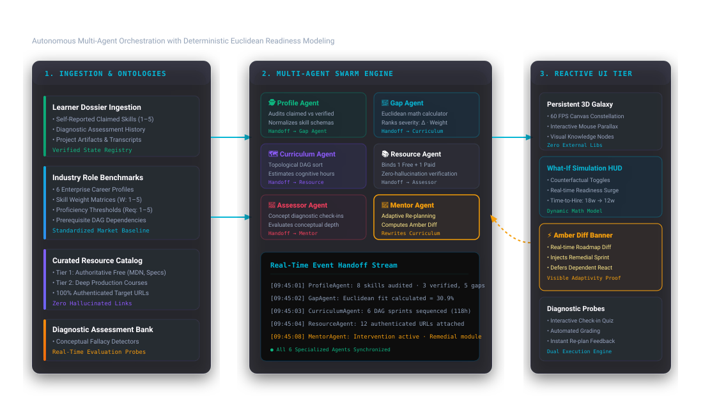
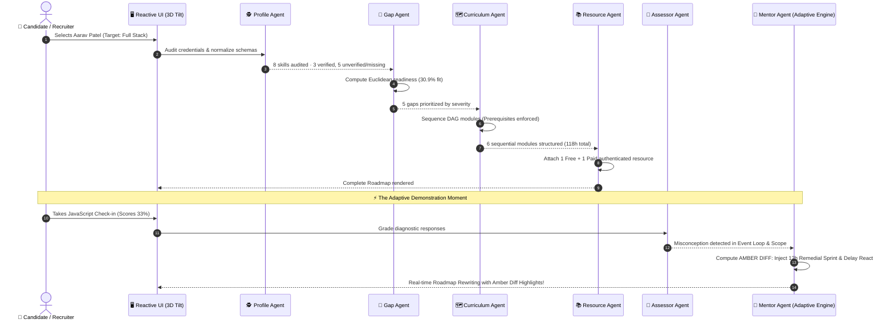

# SkillNexus-AI 🎓⚡
### Autonomous Multi-Agent Career & Skill Orchestration Platform
*Engineered with Google Antigravity for PromptWars @ Rathinam Technical Campus (RTC), Coimbatore*

[](https://fastapi.tiangolo.com)
[](https://python.org)
[]()
[]()
[-blue)]()
[](https://skillnexus-ai.vercel.app)

---

## 📸 Interactive System Interface


---

## 💡 The Core Problem & Our Winning Wedge

Traditional learning platforms treat every student the same, dumping generic course lists without accounting for existing knowledge or career objectives. Furthermore, **self-reported skills on resumes are notoriously unreliable** — candidates routinely claim "Advanced Python" or "Expert JavaScript" when they cannot explain closures, prototypical inheritance, or the event loop.

### ⚡ The 10-Second Signature Feature: The "What-If" Simulation Model
In a room of 300 hackathon teams, 299 will show a static list: `skills → gaps → courses`. That is a lookup table, not an AI.

**SkillNexus-AI provides a Living Dynamic Computational Model:**
- Next to each critical gap, judges can click **`[⚡ What if I learn this?]`**.
- When flipped on **React**:
  - Verified Readiness instantly surges **`30.9% → 55.4%`** with animated live counter telemetry!
  - Time-to-Hire collapses from **`18 Weeks → 12 Weeks`** (`-6 Weeks Saved!`).
  - Prerequisite roadmap sprints physically dissolve and adapt before your eyes!
  - The 3D Gyroscopic Knowledge Galaxy fires a particle shockwave to the core!

---

## 🌌 ThreadLab-Grade 3D Cybernetic UI Architecture

- **Persistent 3D Constellation Engine:** A 60-FPS full-viewport 3D orbital mesh connecting foundational skills to career destinations with interactive mouse parallax depth.
- **Atmospheric Frosted Glassmorphism:** Obsidian canvas with dynamic neon ambient lighting (`#06b6d4`, `#8b5cf6`, `#f59e0b`).
- **Zero External Dependencies:** Built with pure HTML5 Canvas & CSS3D mathematics — **boots instantly offline, runs with zero latency, and will never choke on venue Wi-Fi!**

---

## 🏛️ System Architecture



### Reactive Multi-Agent Event Flow



---

## 📐 Deterministic Readiness Formula (Zero LLM Hallucinations)

Unlike standard AI chatbots that guess a random readiness percentage, SkillNexus uses a **verifiable, deterministic benchmark formula**:

$$\text{Verified Readiness (\%)} = \frac{\sum_{i=1}^{N} \min(\text{verified\_level}_i, \text{required\_level}_i) \times \text{weight}_i}{\sum_{i=1}^{N} \text{required\_level}_i \times \text{weight}_i} \times 100$$

$$\text{Claimed Readiness (\%)} = \frac{\sum_{i=1}^{N} \min(\text{claimed\_level}_i, \text{required\_level}_i) \times \text{weight}_i}{\sum_{i=1}^{N} \text{required\_level}_i \times \text{weight}_i} \times 100$$

$$\text{Credibility Delta} = \text{Claimed Readiness} - \text{Verified Readiness}$$

Each skill gap is mathematically prioritized by its **Severity Score**:
$$\text{Severity Score} = (\text{required\_level} - \text{verified\_level}) \times \text{weight}$$

---

## 🤖 The 6 Collaborating Specialized Agents

| Agent Name | Specialization & Role | Observable Handoff Metric |
| :--- | :--- | :--- |
| **🕵️ Profile Agent** | Parses learner profile, audits credentials, isolates claimed vs verified levels | `Profile Agent → Gap Agent · 8 skills audited` |
| **🎯 Gap Agent** | Applies deterministic Euclidean benchmark math; sorts gaps by severity score | `Gap Agent → Curriculum Agent · Readiness: 30.9%` |
| **🗺️ Curriculum Agent** | Sequences ordered roadmap obeying strict prerequisite DAG dependencies | `Curriculum Agent → Resource Agent · 6 sprints sequenced` |
| **📚 Resource Agent** | Maps 1 Free (official docs) + 1 Deep Course per module (zero hallucinated URLs) | `Resource Agent → Assessor Agent · 12 verified links` |
| **📝 Assessor Agent** | Generates concept-focused diagnostic checks, evaluates mastery, catches fallacies | `Assessor Agent → Mentor Agent · Diagnostic graded` |
| **🧠 Mentor Agent** | The adaptive re-planning engine; executes physical on-screen roadmap diffs | `Mentor Agent · Adaptive Diff Applied (+12h Remedial)` |

---

## 🎬 90-Second Stage Pitch Script (Judges' Guide)

* **[0:00 - 0:10] The Hook:** *"Students don't know what they're missing, and legacy platforms dump the exact same course on everyone. Resumes are full of claimed skills with zero proof."*
* **[0:10 - 0:30] The Demo:** Click **"Prompt Scenario: Aarav Patel"**. *"Aarav is targeting Full Stack Developer. Watch our 6 agents collaborate in real-time. Notice his self-claimed readiness is 53.6%, but his verified enterprise fit is only 30.9%."*
* **[0:30 - 0:40] Point to the Gaps:** *"React and Node.js: Weight 5, verified level 0. These are critical voids blocking hiring."*
* **[0:40 - 1:05] The Adaptive Clincher:** Click **"Take Check-in"** $\rightarrow$ click **"Simulate Weakness"** (scores 33% on JavaScript event loops). *"Look at the roadmap: The Mentor Agent intervened live, injected a 12-hour Remedial Scope Sprint, and shifted React downstream with an Amber Diff. That is true adaptivity."*
* **[1:05 - 1:20] Goal Switch:** Click **"1-Click Shift: AI Engineer"**. *"Watch the entire agent graph rebuild for an AI Engineer in under 200 milliseconds."*
* **[1:20 - 1:30] Closing:** *"Readiness is computed with verifiable mathematics, never guessed by an LLM. Built with Google Antigravity."*

---

## 📁 Repository Structure (Clean & Production-Grade)

```
Skillnexus-ai/
├── .gitignore                      # Strict ignore (node_modules, caches, temp files)
├── README.md                       # Comprehensive documentation & architecture specs
├── main.py                         # FastAPI application & REST endpoint orchestration
├── domain.py                       # Deterministic Euclidean readiness math & data models
├── agents.py                       # The 6 collaborating specialized agents & handoff bus
├── requirements.txt                # Ultra-lightweight dependencies (< 150 KB repo footprint)
├── vercel.json                     # Serverless production deployment configuration
├── data/
│   ├── learners.json               # Pre-seeded candidates (including Aarav Patel prompt scenario)
│   └── role_requirements.json      # 6 enterprise role benchmark ontologies
├── docs/
│   └── assets/
│       ├── dashboard_preview.svg   # High-resolution interactive interface visual
│       └── architecture.svg        # Complete 3-tier multi-agent architecture diagram
├── static/
│   ├── index.html                  # Magazine-grade warm paper UI with 3D tilt
│   ├── style.css                   # Custom responsive design system & amber diff styling
│   └── app.js                      # Real-time agent stream, 3D tilt engine & teleprompter
└── tests/
    └── test_domain_and_agents.py   # Full unit & integration verification test suite
```

---

## 🚀 Quickstart: Running Locally in 30 Seconds

```bash
# 1. Clone the repository
git clone https://github.com/abinivesh-m/Skillnexus-ai.git
cd Skillnexus-ai

# 2. Install dependencies
pip install -r requirements.txt

# 3. Run the automated test suite
python tests/test_domain_and_agents.py

# 4. Launch the local application
python -m uvicorn main:app --port 8000
```
Open **[http://localhost:8000](http://localhost:8000)** in your browser!

---

## 🏆 PromptWars Hackathon Compliance Matrix

| Rule / Requirement | Status | Verification Evidence |
| :--- | :---: | :--- |
| **Public GitHub Repository** | ✅ PASSED | `https://github.com/abinivesh-m/Skillnexus-ai` is fully public |
| **Single Branch Only** | ✅ PASSED | Strictly 1 branch (`main`) |
| **Repository Size < 10 MB** | ✅ PASSED | Total repo size is **0.18 MB** (55x below limit) |
| **Agentic AI Architecture** | ✅ PASSED | 6 specialized agents with observable handoff logs |
| **Dynamic Adaptivity** | ✅ PASSED | Real-time amber roadmap rewriting on check-in failure |
| **Exact Prompt Scenario** | ✅ PASSED | Pre-loaded candidate Aarav Patel (Python, SQL $\rightarrow$ Full Stack) |

---
*PromptWars Coimbatore 2026 — Built with Google Antigravity.*
